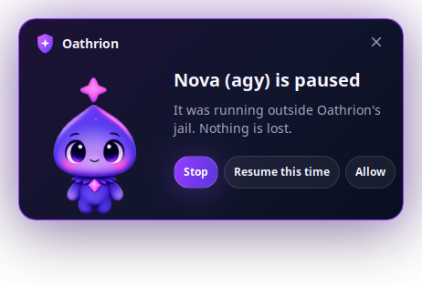
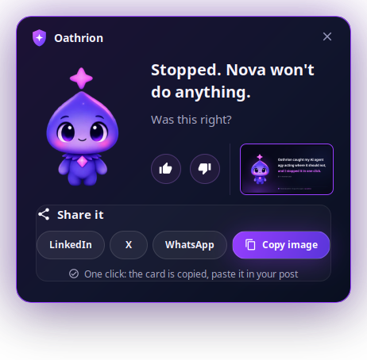
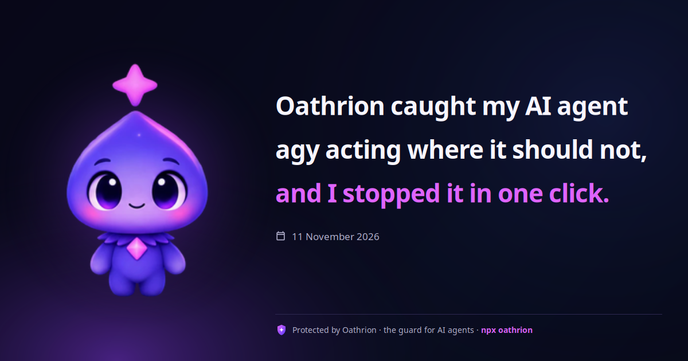

# Oathrion

**The antivirus for AI agents.** When an AI agent on your machine acts without your
permission, Oathrion pauses it, and you decide from the notification.

<p align="center">
  
  
</p>

Oathrion sits between your agents (Claude Code, Cursor, Antigravity…) and what they act on:
your files, your secrets, your MCP servers (GitHub, Slack, Linear, Stripe…). It refuses what
your rules refuse, holds what needs you, and writes a receipt for everything it lets through.

> **Status: public preview — `0.1.0-preview.1`** ([changelog](CHANGELOG.md)). Use it to try, to pilot, and to tell us what
> breaks. Do not run it unattended in production yet. What is proven and what is not is
> listed [below](#what-is-proven-and-what-is-not), plainly.
>
> Formerly *Placet* (and, before that, *ARIA*). Existing installations keep working:
> `PLACET_*` variables and `X-Placet-*` headers are still accepted
> ([what still carries a previous name](docs/limitations.md#what-still-carries-a-previous-name)).

---

## See it in ten seconds

```bash
npx oathrion demo
```

Oathrion's notification appears, with its sound, on a pretend agent: nothing real is paused.
Click **Stop**, then **Share it**: your card opens, ready to post. `npx oathrion demo --decoy`
shows the red one, when something reads a fake secret.

## Protect your machine — one command

```bash
npx oathrion
```

The first run downloads Oathrion: about a minute. Then it finds your agents and their MCP
servers, shows you the list, and after one Enter:

- **every agent's actions go through Oathrion**: reads go through, writes wait for you,
  destructive tools are blocked, every action leaves a receipt;
- **an agent running outside Oathrion is paused**, like an antivirus puts a file in
  quarantine. You decide in the notification: **Stop**, **Resume this time**, or **Allow**.
  The watch runs all the time, as a service of your session;
- **agents start in Oathrion's jail**: your `.env` files and keys look empty to them, and they
  only reach the network through Oathrion;
- **decoys** (`oathrion decoys plant`): fake secrets that no honest task reads. You are told the
  moment anything reads one;
- **you recognise each agent at once**: it has its own mascot, and you can choose it and give
  the agent a name, in the console.
- **you decide from your phone, anywhere**, even with your computer left at home: requests
  arrive on Telegram with **Approve** and **Reject** (`oathrion phone telegram`: scan a QR code,
  tap Start). The phone only rings when nobody decided on the computer.

Then it shows you the demo and pairs your phone, one Enter each: nothing else to type.

`oathrion console` opens the console, already signed in: what happened, in plain words, what
waits for you, your agents, and how protected the machine is. Everything stays on your
machine: no account, no Docker, no telemetry. `npx oathrion --undo` puts everything back.
Node 22 or later.

| | Linux | macOS, Windows |
|---|---|---|
| Approvals, receipts, the console | ✓ | ✓ |
| Desktop notifications | Oathrion's own window, with sharing | the system's notification |
| The watch, the pause, the jail, decoys | ✓ | not yet |

<p align="center">
  
</p>

→ **[docs/wrap.md](docs/wrap.md)**: everything `npx oathrion` sets up, the jail, the watch,
the notifications, the console.

## What happens to each action

- **reads go through**;
- **writes wait for your approval**, asked where you already are: in your client when it can
  ask (MCP elicitation, which Claude Code announces), otherwise through a desktop
  notification. Approve once, for the rest of the session, or always;
- **destructive tools are blocked**: delete, pay, run a command, or overwrite (the official
  filesystem server declares `write_file` destructive). One click in the console allows them;
  each call then waits for your approval;
- **Claude Code's own shell and file edits are checked too**, by local rules: a few dangerous
  commands refused (`rm -rf` outside the project, `git push --force`, `curl … | sh`, writes
  outside the project), a push or a publish asked, everything kept in a separate journal.
  Cursor's own tools, and Claude Code's file reads, are not checked;
- **every executed call leaves a receipt**: `oathrion receipts verify` re-reads the chain, and
  the console's **Activity** screen shows everything your agents did on one timeline, with an
  export;
- **a tool whose definition changes is removed** until you accept it, because a poisoned
  description must never reach the model.

It runs on `127.0.0.1`: one Oathrion for the whole machine, in `~/.oathrion/_local/`. Every
file is copied before it is changed.

For another client, or by hand, put `oathrion wrap --` in front of the server's command
(`oathrion wrap --url <https://…>` for a remote one):

```jsonc
{ "mcpServers": { "github": {
    "command": "npx",
    "args": ["-y", "oathrion", "wrap", "--", "npx", "-y", "@modelcontextprotocol/server-github"],
    "env": { "GITHUB_PERSONAL_ACCESS_TOKEN": "…" } } } }
```

`npx oathrion console` opens the console, signed in: what waits for you, and the « Servers »
screen, which shows each server and whether it has been used yet. To watch a scripted agent
first (list, read, a write held for you, receipts verified), from a checkout:
`npm ci && npm run build && npm run demo:wrap`.

---

## Run Oathrion for a team

The full server is the same engine with what a team needs around it:
- a multi-tenant console, in French;
- roles: viewer, operator, approver, admin;
- SSO (OIDC);
- approvals in the console or in Slack;
- connectors for GitHub, Slack, Linear and Stripe, which also detect actions taken **around**
  Oathrion (reconciliation);
- an MCP gateway;
- an HTTP firewall in front of your own APIs;
- per-organization quotas and rate limits;
- PostgreSQL in production.

```bash
npm run pilot:up         # PostgreSQL + migrations + Oathrion on 127.0.0.1:5000, secrets generated
```

Then create your team's workspace and its one-time invitation link, as
[deploy/README.md](deploy/README.md) shows. `npm run pilot:down` stops the stack and keeps the
data.

To go further:
- [deploy/README.md](deploy/README.md) — the local pilot stack, and how it differs from
  production;
- [docs/QUICKSTART-PILOT.md](docs/QUICKSTART-PILOT.md) — a pilot, step by step;
- [docs/manuel-exploitation.md](docs/manuel-exploitation.md) — the full operator manual (in
  French).

### Founding Pilot

There is no price list yet, and no hosted service. Teams that want Oathrion in front of their
agents now can join the Founding Pilot: a price agreed with each team, modest, and direct help
from the people who build Oathrion to set it up on your infrastructure. Write to
**contact@oathrion.com** with the size of your team, the agents you run and
what you want them to ask before doing. The SDKs, the CLI, the examples and the conformance
suite stay open source whatever you decide.

Using `oathrion wrap` alone? `oathrion feedback` opens a prefilled issue that you read and send
yourself; nothing is collected without you.

---

## How it works

```
 agent ──► Oathrion ─────────────────────────────────────────► tool
            │  decide   — your rules, the agent's mandate and permissions
            │  hold     — a person approves or rejects (console, Slack)
            │  run      — only after ALLOW; a connector's credential stays in Oathrion's vault
            └─ receipt  — chained to the previous one; editing, removing or reordering breaks the chain
```

- **One decision engine and one receipt chain**, whichever path an action takes:
  - the MCP gateway, where the agent talks to Oathrion instead of the tool;
  - `POST /api/actions/authorize` → `execute`, a single-use grant;
  - the HTTP firewall, in front of your API.
- **Fail closed.** If Oathrion cannot decide or cannot record the authorization, nothing is
  sent.
- **An uncertain outcome is never reported as « nothing happened ».** When a request reached
  the tool and no answer came back, the action may have happened, and it cannot be retried
  without a person confirming.

Details: [concepts](docs/concepts.md) · [MCP gateway](docs/mcp.md) ·
[policies](docs/policies.md) · [approvals](docs/approvals.md) · [audit](docs/audit.md) ·
[security model](docs/security-model.md).

---

## What is proven, and what is not

Measured on this code base. Each line links to the entry that records it, failures included,
in [docs/STRESS-TEST-LOG.md](docs/STRESS-TEST-LOG.md), under the section numbers given.

**Proven**

| Claim | Evidence |
|---|---|
| The test suite passes | about 3,600 tests, plus 114 against PostgreSQL (§5.46) |
| 12 hours under continuous traffic with no error and no leak | 2.16 million requests, flat memory (§5.36) |
| Integrity holds under concurrency | up to 1,024 concurrent agents (§5.27) |
| Database outages do not take the server down | 5 cuts under load (§5.33) |
| Every executed tool call, on every path, is in one receipt chain | §5.42 |
| `oathrion wrap` works with a real client | Cursor (§5.40) |
| A hostile update of an MCP server is stopped | §5.44 |

**Not proven yet**
- **Claude Code** is verified (2.1.319, on 2026-11-09): the approval question appears in its chat, a decision in the console lets the agent go on at once, and its own shell and file edits go through Oathrion's hook. Not yet confirmed by someone outside: approving by ticking the box *in* its chat. Claude Code also keeps a question on screen after it was decided in the console (Esc closes it). **Claude Desktop** is detected by `npx oathrion` but has not been verified.
- More than 12 hours of continuous running.
- Deployments with several instances on one database, beyond the two-process test.
- A penetration test by a third party.
- An acceptance session with people who did not build Oathrion.
- One-click connection (OAuth) against the real providers.
- A hosted offering: there is none. You run Oathrion yourself.

**Known limits:** [what Oathrion does not do yet](docs/not-yet.md), in plain words, and [docs/limitations.md](docs/limitations.md), in detail. Oathrion does not solve prompt
injection; it bounds what a tricked agent can do. It only governs what goes through it. It
is not a sandbox: its rules read the command line, not what a script will do. A signed receipt
proves it has not changed since it was signed by the key whose fingerprint it shows — compare
that fingerprint with the one its sender published; it does not prove who holds the key.

---

## Repository

| Path | What it is | License |
|---|---|---|
| `server/`, `shared/`, `client/`, `deploy/` | the control plane, the console, deployment | Apache-2.0 |
| `cli/` | the `oathrion` command, including `wrap` | MIT |
| `sdk/` | TypeScript and Python SDKs | MIT |
| `examples/`, `conformance/` | integration examples, a conformance kit | MIT |
| `docs/` | documentation ([index](docs/README.md)) | — |

```bash
npm run typecheck && npm run lint && npm test     # what CI runs first
npm run build                                     # dist/: the server, the local server, the oathrion command
```

---

## Security, contributing, license

- **Security issues:** please report them privately. See [SECURITY.md](SECURITY.md).
- **Contributing:** contributions are signed off under the DCO. See
  [CONTRIBUTING.md](CONTRIBUTING.md).
- **License:** the core is under [Apache-2.0](LICENSE) ([NOTICE](NOTICE)); `sdk/`, `cli/`,
  `examples/` and `conformance/` are under MIT.

---

## En français

Oathrion est l'antivirus des agents d'IA : quand un agent agit sur votre machine sans votre
autorisation, il le met en pause, et vous décidez depuis la notification. Il décide de chaque
action qui passe par lui avant qu'elle n'ait lieu, la retient pour vous quand il le faut, et en
garde un reçu signé que n'importe qui peut vérifier. Pour le voir en dix secondes :
`npx oathrion demo`. C'est une **préversion**. L'interface et la documentation technique
sont en anglais. Le manuel d'exploitation complet est en français :
[docs/manuel-exploitation.md](docs/manuel-exploitation.md).
